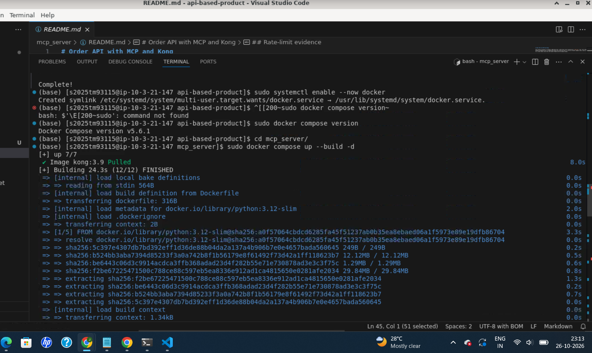
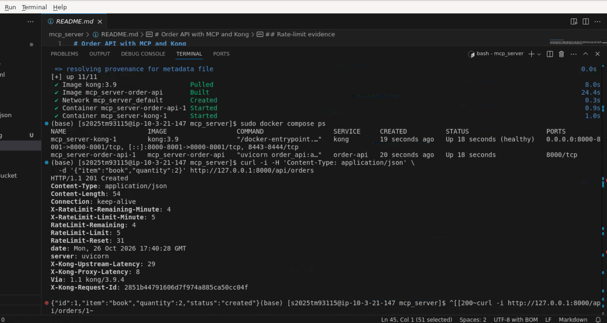
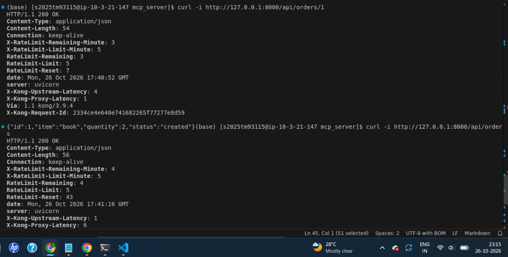
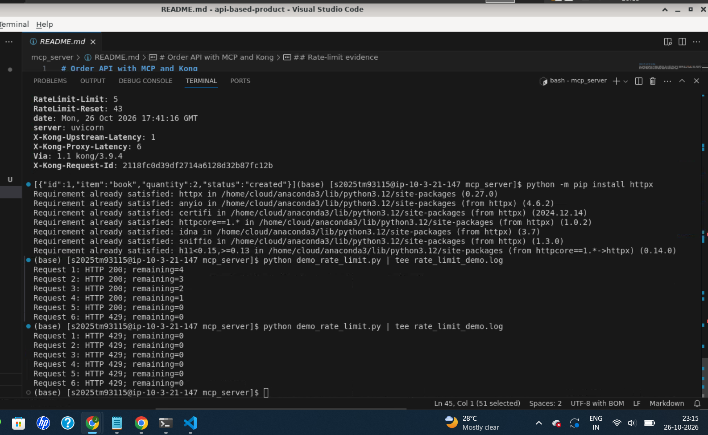
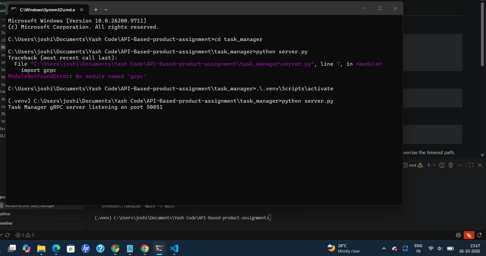
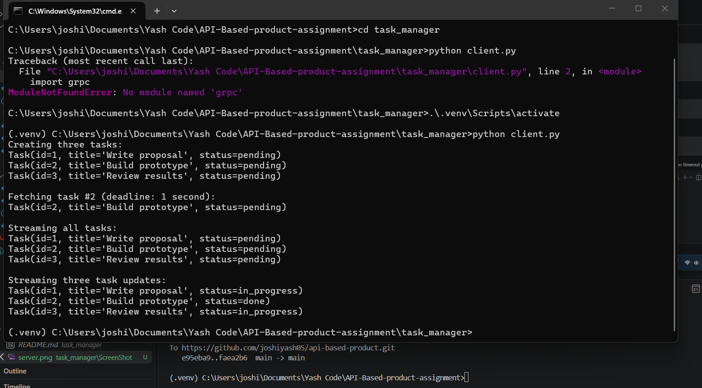
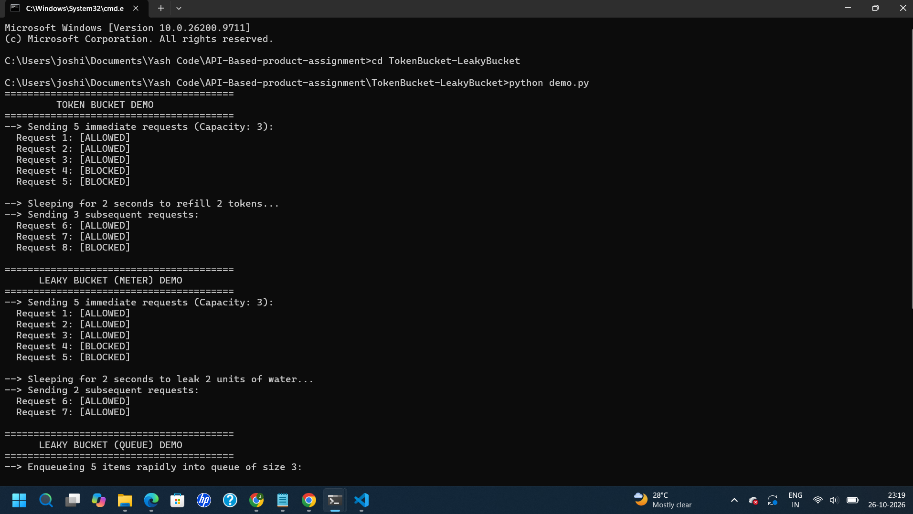
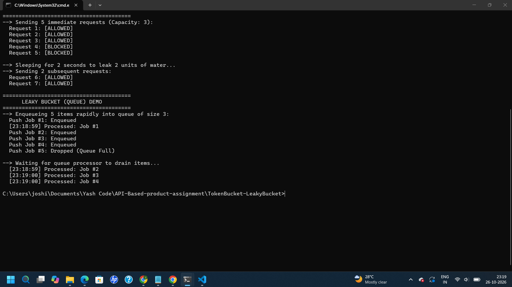

# Assignment Projects

This repository contains three independent Python projects. Run each project's commands from its own directory.

## Projects

### Order API with MCP and Kong

An in-memory order REST API, an MCP stdio server exposing the API as an `order_api` tool, and a Kong Gateway configured to limit clients to five requests per minute.

More details: [mcp_server/README.md](mcp_server/README.md).

#### Start the API and gateway

Install Docker Engine and the Docker Compose plugin, then run from the repository root:

```bash
cd mcp_server
docker compose up --build -d
docker compose ps
```

The API is available through Kong at `http://127.0.0.1:8000`. Try creating and listing an order:

```bash
curl -i -H "Content-Type: application/json" \
  -d '{"item":"book","quantity":2}' http://127.0.0.1:8000/api/orders
curl -i http://127.0.0.1:8000/api/orders
```

#### Run the rate-limit demonstration

From `mcp_server/`, install the demo dependency and send six requests. The first five should return HTTP 200; the sixth should return HTTP 429.

```bash
python -m pip install httpx
python demo_rate_limit.py
```

#### Run the MCP server

In another terminal, from `mcp_server/`, install the project dependencies and start the stdio server:

```bash
python -m venv .venv
source .venv/bin/activate
python -m pip install -r requirements.txt
ORDER_API_BASE_URL=http://127.0.0.1:8000/api python mcp_server.py
```

On Windows PowerShell, activate the virtual environment with `.\.venv\Scripts\Activate.ps1` and set the URL with `$env:ORDER_API_BASE_URL = "http://127.0.0.1:8000/api"` before running `python mcp_server.py`.

Stop the Docker services from `mcp_server/` with `docker compose down`.

#### Screenshots

Docker setup and startup:





API requests and responses:



Rate-limit results:



### gRPC Task Manager

An in-memory gRPC service that creates, retrieves, lists, and updates tasks. It demonstrates unary calls, server streaming, bidirectional streaming, status validation, and client deadlines.

More details: [task_manager/README.md](task_manager/README.md).

#### Setup

Run these commands from `task_manager/`:

```powershell
python -m venv .venv
.\.venv\Scripts\Activate.ps1
python -m pip install -r requirements.txt
python -m grpc_tools.protoc -I. --python_out=. --grpc_python_out=. task_manager.proto
```

#### Run the server and client

Start the server in one terminal:

```powershell
cd task_manager
.\.venv\Scripts\Activate.ps1
python server.py
```

In a second terminal, run the client:

```powershell
cd task_manager
.\.venv\Scripts\Activate.ps1
python client.py
```

The client creates tasks, fetches a task with a deadline, streams the task list, and sends task updates.

#### Screenshots





### Python Rate Limiters

Thread-safe Token Bucket and Leaky Bucket implementations, with a runnable demonstration and unit tests. This project uses only the Python standard library.

More details: [TokenBucket-LeakyBucket/README.md](TokenBucket-LeakyBucket/README.md).

Run from `TokenBucket-LeakyBucket/`:

```bash
cd TokenBucket-LeakyBucket
python demo.py
python -m unittest test_rate_limiters.py
```

#### Screenshots





## Requirements

- Python 3.10 or newer for the Order API/MCP project, plus Docker Engine and Docker Compose for the API and gateway.
- Python and the packages in `task_manager/requirements.txt` for the gRPC project.
- Python 3.10 or newer for the rate-limiter project.

See each project's README for additional details. The original assignment reference is [Assignment.pdf](Assignment.pdf).
